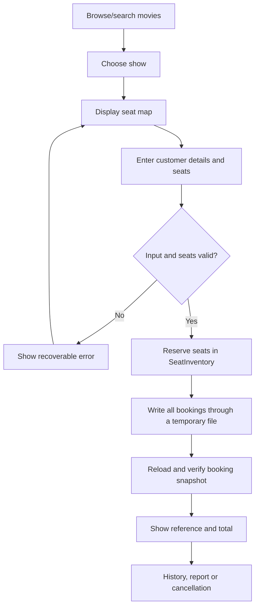
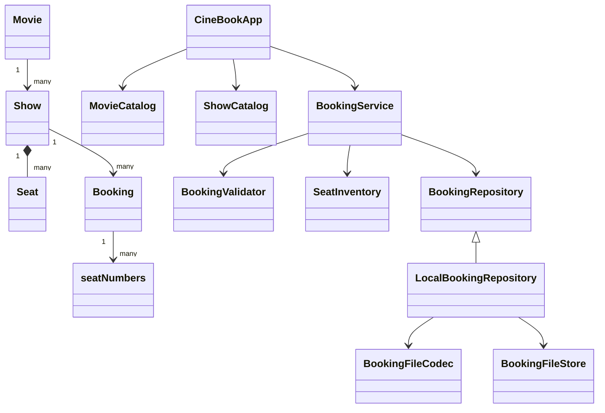

# CineBook Phase 1 design

## Package and class responsibilities

All 20 top-level classes are in package `cinebook` at `outputs/CineBookPrototype/src/cinebook/`.

| Responsibility group | Classes |
|---|---|
| Application / console | `CineBookMain`, `CineBookApp`, `ConsoleMenu`, `InputReader` |
| Domain models and catalogues | `Movie`, `Show`, `Seat`, `Booking`, `MovieCatalog`, `ShowCatalog` |
| Booking rules and inventory | `BookingValidator`, `BookingReferenceGenerator`, `SeatInventory`, `BookingService` |
| File persistence | `BookingFileCodec`, `BookingFileStore`, abstract `BookingRepository`, `LocalBookingRepository` |
| Presentation / report | `SeatMapFormatter`, `BookingReportService` |

The count is 20 top-level class declarations. `BookingRepository` is abstract; no top-level enum/interface/helper declarations are present in this Phase 1 prototype.

## Booking flow

## Model relationships

## File format and persistence

The booking file is UTF-8 CSV with a fixed header. Each row records booking reference, show/movie/cinema details, customer name/email, selected seat IDs, total, timestamp, and cancellation status. `BookingFileCodec` escapes and parses CSV fields. `BookingFileStore` writes a complete replacement into a temporary file and moves it into place; `LocalBookingRepository` maps the text records to `Booking` objects. `BookingService` loads active bookings and reserves their seats at startup. After a new booking is saved, the service reloads it and verifies reference, seats, and total before reporting success.

Cancellation persists the cancelled flag before releasing seats in memory. This is a local single-process prototype; it does not provide file locking across independent running processes.
